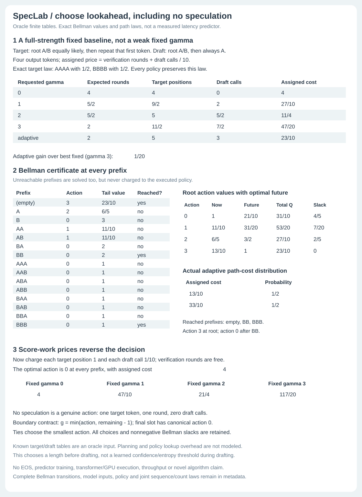

# Exact oracle lookahead policies

SpecLab v0.3 asks a different question from the residual-correction audit:
**which draft length should a tiny fully known model choose, including no
speculation at all?** This is an exact planning laboratory, not a latency
predictor, trained stopping head or new speculative-decoding algorithm.



## State and action contract

The state is the entire emitted prefix, with the fixed finite horizon inherited
from `FiniteModel`. Before each round, choose an action `a` from 0..`max_gamma`,
where `max_gamma` is 1..3. Action 0 directly draws one target token with one
modeled verification round, one target position and zero draft calls. Positive
actions use the existing exact residual-correction block kernel. The boundary
contract remains `g=min(a, remaining-1)`, reserving a correction/bonus slot.
We keep only distinct effective actions: at the last slot the only action is 0;
with two slots remaining, the only actions are 0 and 1. This removes duplicate
choices without removing an attainable decoding behavior or count law.

The policy maps **every** nonterminal prefix to a canonical action, including
prefixes unreachable under its own execution or even under the target model.
Those values support inspection and alternate starts, not costs charged to the
root execution. Prefixes at which a round never begins do not consume a policy
lookup or decoder round in the modeled path. A complete emitted prefix is
sufficient for our known autoregressive tables and additive cost, so there is
no hidden belief state, time-varying price or history-dependent hardware load.

This chooses the block length **before drafting**, using complete exact target
and draft tables. It does not observe in-progress proposals and then stop based
on their confidence. Planning needs target information that a practical draft
controller usually does not have cheaply. The planner's table lookups, full
branch enumeration, memory, policy lookup and preprocessing are **not** charged
to decoder counters; including them could erase the assigned-cost gain.

## Objective and Bellman certificate

Prices are exact nonnegative rationals for each modeled verification round,
target position scored and draft call. They are caller-assigned abstract units,
not measured seconds, FLOPs, energy or money. A branch with counts `c` costs

```
price_round * c.verification_rounds
+ price_position * c.target_positions
+ price_draft * c.draft_calls
```

Given prefix `s`, action `a` has an exact finite branch law `K(s,a)`. Each branch
emits at least one token and at most the remaining horizon. With terminal value
zero, the planner computes backwards:

```
Q(s,a) = sum_b K(s,a)[b] * (cost(b) + V(s + emitted(b)))
V(s)   = min_a Q(s,a)
```

Every tail is longer than its parent, so this is a finite acyclic recursion.
Induction from terminal prefixes proves the stored value is minimal among
**deterministic prefix-conditioned policies in this finite action set and cost
model**. The selected action realizes that minimum; ties pick the smallest
effective draft length, including action 0. Every action's immediate expected
cost, future expected cost, total Q, transition probabilities, optimal tail
values and nonnegative Bellman slack `Q-V` are retained for every prefix.
This is not a proof that an online learned stopping rule is optimal, or that
our action set contains every practical draft-tree/early-stopping controller.

The selected policy is then evaluated separately by composing complete kernels.
The report retains its full sequence law, joint sequence/count law, marginal
count law, costs attached to each count event, expected counts, and reached
round kernels. The independently computed expected assigned cost must equal
the root Bellman value. The sequence law must equal ordinary target-only
sampling exactly. Choosing a deterministic length from the emitted prefix does
not change the residual correction argument at that prefix. No numerical
tolerance, Monte Carlo statistic or iid acceptance assumption is used.

## Baselines that are allowed to win

Every report evaluates every fixed choice 0..`max_gamma`, applying the same
boundary convention. Fixed zero is full target-only generation, not a weak
draft model or weakened gate. Best fixed is selected by exact assigned cost,
with the smallest requested gamma breaking ties. Optimized cost must be no
worse than this best fixed, because each fixed policy belongs to the planner's
policy class. The optimizer is not guaranteed a *strict* gain.

The four-token fixture uses `P(A)=P(B)=1/2` at the root, then repeats the first
token deterministically. The draft shares the root distribution but always
proposes A afterwards. Both models fully specify all prefixes, including
unreachable mixed-token prefixes. All policies output AAAA and BBBB with mass
1/2 each. Under assigned prices round=1, position=0, draft=1/10:

| Policy | Expected rounds | Target positions | Draft calls | Assigned cost |
| --- | ---: | ---: | ---: | ---: |
| Fixed 0 (target only) | 4 | 4 | 0 | 4 |
| Fixed 1 | 5/2 | 9/2 | 2 | 27/10 |
| Fixed 2 | 5/2 | 5 | 5/2 | 11/4 |
| Fixed 3 (best fixed) | 2 | 11/2 | 7/2 | 47/20 |
| Optimal prefix policy | 2 | 5 | 3 | 23/10 |

The exact gain over best fixed is `1/20` assigned units. It is a **descriptive
fixture comparison under the declared objective**, not a real throughput
improvement or an isolated empirical causal effect. The adaptive policy starts
with action 3. With probability 1/2 it emits AAAA in one round, cost 13/10. With
probability 1/2 it emits BB after the first rejection, then chooses action 0 at
BB and BBB, total cost 33/10. Those are the only prefixes reached as round
starts: empty, BB, BBB. For example, action 1 at AA appears in the certificate
but is not executed along a root-start path. The first rejected proposal is at
index 1 because the root proposal itself is always accepted.

Changing the assigned objective to round=0, position=1, draft=1/10 yields
fixed costs `4`, `47/10`, `21/4`, `117/20`. The optimizer selects 0 at **every**
prefix and costs 4, tying target-only. Score work pays for all positions, even
discarded proposals, so unnecessary speculation is not made to look cheaper.
With all prices zero the deterministic tie rule again selects zero everywhere.
Identical target/draft tables under round prices do choose long speculation;
this is not a controller hard-coded to avoid drafting.

## API, input and commands

```python
from speclab.policy import optimize, evaluate, policy_from_records

prices = {"verification_rounds": 1, "target_positions": 0, "draft_calls": "1/10"}
report = optimize(target, draft, prices, max_gamma=3)
policy = policy_from_records(target, report["optimal"]["policy"], max_gamma=3)
check = evaluate(target, draft, policy, prices, max_gamma=3)
```

```
python -m speclab.policy demo
python -m speclab.policy optimize examples/policy-input.json
python examples/render_policy.py --check
```

The strict input has exactly `target`, `draft`, `prices`, `max_gamma`. The model
schema and exact-rational restrictions are unchanged from
[STOCHASTIC.md](STOCHASTIC.md). Prices have exactly `verification_rounds`,
`target_positions`, `draft_calls`. Unknown/missing/duplicate keys, floats,
bools, negative prices, nonfinite values and inputs above 2 MB fail; max gamma
must be integer 1..3. CLI errors exit 2 with empty stdout. Policy records must
have exactly prefix/action, no repeated prefix, exact coverage and canonical
allowed integer actions. Arbitrary partial policies are not silently filled.

## Verification and packaging

The complete suite now has 47 tests, including the original 34 and 13 additive
policy/figure tests. Independent tests do not simply ask Bellman to confirm
its own Bellman recursion:

* At horizon 3, there are exactly 12 distinct binary prefix policies with
  actions 0..3 after boundary canonicalization: three root choices, two at
  each length-one prefix, and only zero at the four final-slot prefixes.
  Every one is exhaustively evaluated by an independent **marginal** proposal
  recursion for all 25 binary quarter-grid target/draft pairs. Its minimum is
  compared against the optimizer under three objectives, giving 75 checks.
* Six additional prefix-dependent table pairs exercise all 12 policies, with
  full joint sequence/count laws independently compared, not just means.
  This reference sums accepted `min(p,q)` mass and rejected `(p-q)+` mass
  without generating full draft paths or calling the production kernel.
* 36 vocabulary/horizon/gamma-limit cases check sizes 1..3, horizons 1..4,
  gamma limits 1..3, exact target-law equality, counter identities and all
  fixed baselines. Tests separately verify each Bellman action, transition,
  tail value and slack, fixed-policy parity with the v0.2 stochastic engine,
  strict invalid policies/prices/CLI behavior and no global RNG/input mutation.

The SVG binds all **115** displayed data cells and the complete compressed
report. A hidden transition-mass change alters metadata even when every visible
cell stays fixed. CI checks old gates and old stochastic artifacts unchanged,
the new saved full demo and exact SVG regeneration on Python 3.10-3.13, plus
all seven command modes from the installed 12-module wheel outside checkout.

## Related work and distinctions

This project's finite planner and fixtures are written here. Adaptive lookahead
and dynamic programming are established ideas; no external code was copied.
These sources guide scope, not evidence of this project's hardware performance:

1. [Leviathan, Kalman and Matias, ICML 2023](https://proceedings.mlr.press/v202/leviathan23a/leviathan23a.pdf): underlying speculative residual correction, bonus token, and cost/acceptance assumptions. This planner uses exact finite prefix conditionals, not their iid long-run cost formula.
2. [Mamou et al., Dynamic Speculation Lookahead, 2024](https://proceedings.mlr.press/v262/mamou24a.html): DISCO dynamically chooses lookahead using a classifier. Our full-known-table oracle does not train or implement that classifier.
3. [SpecDec++, 2024](https://arxiv.org/html/2405.19715v2): formulates adaptive candidate stopping as an MDP and derives a sufficient stopping condition, then trains an acceptance prediction head. Its within-round state includes draft candidates; ours chooses a length at round start from emitted prefix alone. We do not present their threshold theorem as the theorem of this smaller model.
4. [AdaEDL, 2024](https://arxiv.org/html/2410.18351): training-free early stopping from an approximate entropy-based acceptance bound. We do not implement that approximation or infer acceptance from draft entropy alone.
5. [Hugging Face and Intel, Faster Assisted Generation with Dynamic Speculation, October 8, 2024](https://huggingface.co/blog/dynamic_speculation_lookahead): distinguishes a zero-temperature greedy mismatch oracle from practical draft-confidence stopping. Our stochastic finite-model expected-cost oracle is neither that hindsight oracle nor its confidence-threshold implementation. Historical default/version and hardware figures in that post are not used as current framework or local performance claims.
6. [Current Transformers assisted-decoding documentation](https://huggingface.co/docs/transformers/assisted_decoding): framework context for dynamic assisted decoding; this dependency-free package does not wrap Transformers or download models.

Limitations: tiny complete supplied tables, no EOS, no on-the-fly proposal-aware
policy, no learned acceptance predictor, no entropy-bound controller, no unknown
model learning, no stochastic hardware queues or calibrated runtime cost, no
KV cache/GPU kernel, and no LLM quality or throughput claim. The original
ngram greedy demo and v0.2 stochastic sampler remain available unchanged.
