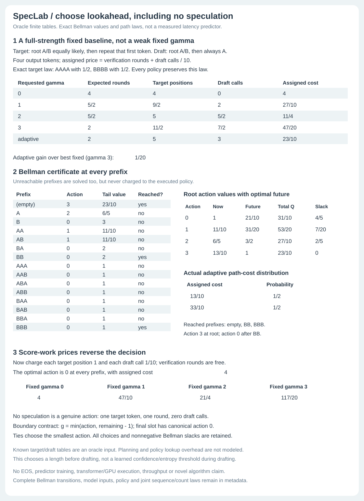
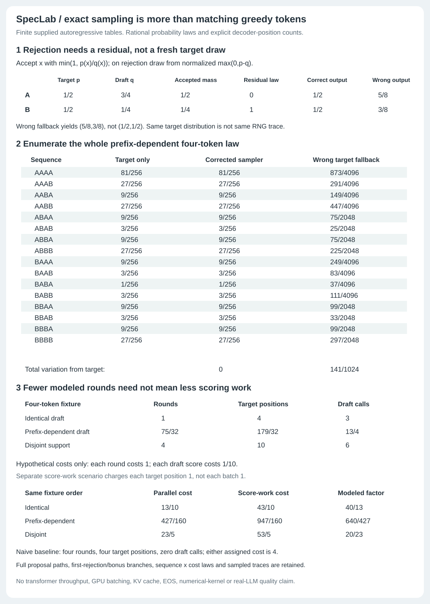

# SpecLab

Speculative decoding is easy to describe and easy to get subtly wrong. SpecLab uses small models whose full output laws can be checked, so correctness and work counts do not depend on a benchmark average.

The project has a greedy n-gram decoder, an exact stochastic sampler, an oracle lookahead planner and a lab for stopping a draft mid-proposal. All run offline in Python's standard library. There is no trained LLM, paid API or measured speedup claim.

[Open the stopping lab](https://midya8.github.io/speclab/)

## Try it

```bash
python -m speclab evaluate
python -m speclab evaluate --format json
python -m speclab gates --require-identical \
  --min-acceptance 0.6 --min-eval-savings 0.5
bash examples/demo.sh
```

For an exact stopping report that can be independently replayed:

```bash
python -m speclab.stopping_cli audit examples/stopping-input.json > /tmp/report.json
python -m speclab.stopping_cli verify examples/stopping-input.json /tmp/report.json
```

## Stop drafting without losing the sampled token

A draft can stop after drawing a low-confidence token. Keeping that token for verification is different from erasing it and pretending it was never sampled.

Take `p=(1/2,1/2)` and `q=(3/4,1/4)` over two tokens. Keep-and-verify preserves the target's full output law. The deliberately wrong censor-and-forget control has full-sequence total variation `1/8`. This control is defined here, not attributed to a library.

The Python `Fraction` engine records every stopped proposal leaf, verification branch, final sequence/count joint law and operation count. A separate verifier enumerates full draft paths and expands decoding states forward. The editable browser lab uses a third BigInt implementation, not precomputed reports. Downloaded evidence can be replayed in Python.

Twelve controls cover prefix-dependent stopping, identical models, disjoint support, threshold boundaries and mass `2^-128`. Fixed-length and target-only baselines stay in the report even when they beat the chosen stopping rule. [Rules, proof, counters and limits](STOPPING.md).

## Choose a draft length, including zero



The oracle planner chooses length 0..3 before each round from the emitted prefix. It knows every target and draft conditional. Every Bellman action value, transition and slack is kept, then the selected policy's full sequence/count law is evaluated separately.

On the four-token switching fixture, its assigned cost is `23/10`, versus best fixed `47/20`: a difference of `1/20` hypothetical units. Charge target positions instead of rounds and it chooses no speculation everywhere. Both choices preserve the target output law. Unreachable decisions are shown but not charged as executed work.

```bash
python -m speclab.policy demo
python -m speclab.policy optimize examples/policy-input.json
python examples/render_policy.py --check
```

This is a full-known-table planner, not a learned controller or a new adaptive-decoding algorithm. Planning, table evaluation and policy lookup overhead are not priced. The proof covers this finite action set and assigned objective, not practical latency. [Bellman proof, baselines and prior work](LOOKAHEAD.md).

## Sample from the target law



The stochastic engine samples from a finite autoregressive draft table, accepts with `min(1,p/q)` and uses normalized positive-residual correction after rejection. It keeps every proposal, first rejection and bonus witness, plus the complete output law and joint sequence/count law. A procedural integer-ticket sampler runs separately from the law enumerator.

Same output law does not mean same output under the same seed. Nor can target fallback simply replace residual correction: on the prefix-dependent control, that wrong fallback has TV `141/1024`; the corrected law has TV `0` for every displayed sequence.

The four-token mismatch averages `75/32` modeled verification rounds, `179/32` target positions and `13/4` draft calls. An assigned parallel-cost scenario improves while a position-score-work scenario gets worse. Neither measures GPU throughput or FLOPs.

```bash
python -m speclab.stochastic demo
python -m speclab.stochastic audit examples/stochastic-input.json
python -m speclab.stochastic sample examples/stochastic-input.json --seed 19
python examples/render_stochastic.py --check
```

[Correction proof, schema, count contract and sources](STOCHASTIC.md).

## The original greedy n-gram experiment

The draft proposes a block of characters. The target confirms matching greedy choices, or replaces the first mismatch with its own choice. Every emitted token is therefore a target greedy choice. That is the ideal algorithm's invariant; finite tests check this implementation rather than proving its code.

The tests compare four draft/target configurations, three generation lengths and block sizes 1, 2, 4 and 8. Models use counts from one deterministic corpus, with vocabulary-order tie breaking.

For the checked-in order-3 draft/order-4 target fixture, eight prompts of 60 tokens at gamma 4 give mean draft acceptance `0.800`. There are 122 modeled verification rounds versus 480 target-only rounds, a 74.6% reduction in that counter. Actual sequential target scoring takes **510 calls versus 480**, so it is not a measured compute saving. Draft calls are counted separately. An order-2/order-3 mismatch drops acceptance to about `0.03`; that failure stays in the tests.

A modeled round represents a batched target verification pass. This implementation performs the position scores sequentially and does not benchmark the hardware assumptions needed to turn fewer rounds into lower wall time.

## Checks

```bash
python -m unittest discover -s tests -v
python examples/check_stopping.py
node --test tests/test_stopping.cjs tests/test_stopping_browser.cjs
```

The current suite has 61 Python tests and four Node/actual-Chrome tests. Python CI runs on 3.10-3.13. The installed-wheel job checks all earlier command modes plus stopping audit, verify and demo outside the checkout.

The method notes keep the detailed checks and historical suite counts: 14 original greedy tests, 34 after stochastic sampling and 47 after lookahead planning. They include 225 one-step distribution pairs, 2,187 prefix-table pairs, exact RNG-ticket enumeration, all 12 tiny prefix policies for 25 model pairs under three objectives, and independent full-law comparisons. The figures bind 96 stochastic and 115 policy data cells. Browser tests inspect all 12 stopping reports and their leaves/branches, trusted edit invalidation, actual downloads and 320/390/1280 layouts.

## Limits

Exact table experiments use 1..3 tokens, horizon 1..4 and maximum draft length 1..3. They require complete supplied conditionals, including unreachable prefixes. There is no EOS, tokenizer mismatch, real-model training, KV cache or GPU kernel. The original n-gram demo is greedy only; it is separate from the exact stochastic engines.

Work counters describe modeled decoding paths, not the cost of enumerating those paths or running a verifier. Assigned costs are not calibrated runtime costs. The small examples establish neither LLM-scale acceptance rates nor a quality, latency or deployment benefit. Standard speculative sampling and adaptive lookahead work are credited in the method notes.

## License

MIT
