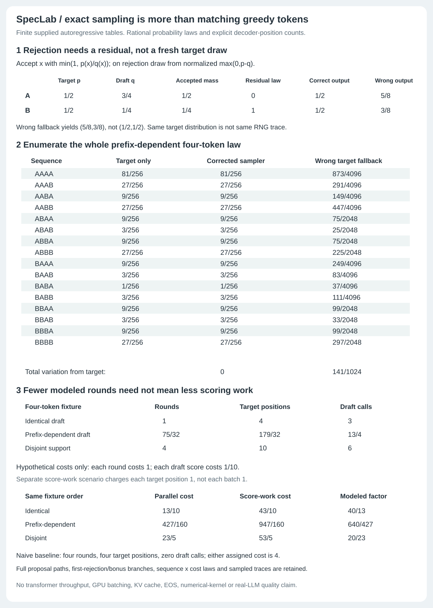

# Exact stochastic speculative decoding

SpecLab v0.2 preserves the original n-gram greedy demo and adds an independent
finite autoregressive-table engine. The new claim is **equality of the output
probability law**, not same-seed token identity and not a measured speedup.



## One-token correction

Write `p` for the target distribution and `q` for the draft distribution.
The draft draws `x ~ q`. Accept it with `a(x)=min(1,p(x)/q(x))`. A token with
`q(x)=0` is never proposed; its acceptance probability is reported as null,
not obtained by dividing by zero. The accepted joint mass at each token is
`q(x)a(x)=min(p(x),q(x))`. Let

```
alpha = sum_x min(p(x),q(x)) = 1 - TV(p,q)
reject = 1 - alpha
residual(x) = max(0,p(x)-q(x)) / reject
```

On rejection, draw from `residual`. Its unnormalized mass sums to `reject`.
Accepted mass plus rejected-and-replaced mass is exactly
`min(p(x),q(x)) + max(0,p(x)-q(x)) = p(x)`. If `reject=0`, the residual is null
and is never sampled. Target support need not be contained in draft support.
Every token's probabilities, acceptance ratio, accepted mass, residual mass,
residual law and reconstructed target mass remain in the certificate.

The fault-injection control keeps the correct acceptance rule but incorrectly
uses `p` directly on rejection. Its output mass is
`min(p(x),q(x)) + (1-alpha)p(x)`, which is not generally `p(x)`. For
`p=(1/2,1/2), q=(3/4,1/4)` it produces `(5/8,3/8)`. This is different from
ordinary rejection sampling with a suitable envelope constant and fallback.
The latter can be correct, but is not the accept rule being fault-injected here.

## Autoregressive blocks and finite-horizon contract

For a supplied prefix, draft `g` tokens autoregressively using the actual draft
conditionals on the draft path. Score the target at all `g+1` prefixes on that
path, including the bonus prefix. Check proposals left to right. On the first
rejection, emit the accepted draft prefix plus one residual correction and
discard the remaining draft suffix. If all proposals are accepted, emit them
plus one bonus target token. The checks and target/draft distributions are
conditioned on the same accepted prefix up to the first rejection.

With `r` output slots remaining, this implementation uses
`g=min(gamma,r-1)`, reserving a correction/bonus slot. It never overshoots the
finite horizon. At the last slot, `g=0`: no drafting, one target bonus draw.
This explicit terminal convention differs from implementations that draft to
the horizon and simply suppress a bonus. Their work counts need not match.
There is no EOS token, prompt lookup, adaptive lookahead or early stopping.

`round_kernel` enumerates every positive-probability full draft path. Each
first-rejection and all-accepted bonus branch retains its draft-path mass,
accepted-prefix probability, rejection ratio, replacement distribution/token,
emitted sequence and exact joint branch probability. Unused future drafts
remain in these witnesses because they were generated before verification.
All zero-probability paths and branch events are omitted. The branch mass sums
to one, including for identical or disjoint-support models.

`enumerate_decode` composes those variable-length kernels until the requested
horizon. It retains the full sequence law, joint sequence/count law, marginal
count law, expected counts and every reachable round kernel. Target-only
reference generation independently multiplies target conditionals along each
complete sequence. `audit` checks exact total variation zero for the corrected
law and separately returns the complete wrong-fallback control. Equality of
the law follows from the correction identity applied at each accepted prefix;
the finite enumeration tests validate this implementation, not every possible
language model or numerical kernel.

## A separate procedural sampler

`sample` does not draw from an enumerated round kernel. It actually generates
draft tokens, scores all target positions, makes acceptance decisions and draws
a residual or bonus token. Categorical draws use exact integer tickets after
finding a common denominator; Bernoulli draws use the acceptance fraction's
numerator and denominator. No floating-point CDF or acceptance tolerance is
used. The sampler uses a private seeded `random.Random`, not the global RNG.
The trace includes the full proposal path, all checked proposal certificates,
accept/reject decisions, replacement law, emitted tokens and counters.

A seed makes this sampler reproducible. It does **not** couple its output to
naive sampling with the same seed: the two consume different random tickets.
In the uniform identical-model four-token control, seed 1 gives naive
`A,A,B,A` and speculative `A,A,B,B`, while the exact sequence laws still agree.

## Count contract, not a throughput claim

Each round with lookahead `g` charges:

* one **modeled verification round**;
* `g+1` **target positions scored**, even when rejection makes some unused;
* `g` **draft calls**, including proposals later discarded.

The sampler performs these positional table lookups sequentially. The exact
law enumerator performs additional analytical work that is **not** represented
by decoder counters; those are costs of the modeled decoding path, not profiler
measurements of the enumerator itself. Accepted draft tokens, rejection rounds
and bonus tokens are also tracked. Every terminal path obeys

```
target_positions = verification_rounds + draft_calls
horizon = accepted_draft_tokens + rejection_rounds + bonus_tokens
```

The four-token controls give these exact expectations:

| Fixture | Rounds | Target positions | Draft calls | Correct TV | Wrong-fallback TV |
| --- | ---: | ---: | ---: | ---: | ---: |
| Identical target/draft, gamma 3 | 1 | 4 | 3 | 0 | 0 |
| Prefix-dependent mismatch, gamma 2 | 75/32 | 179/32 | 13/4 | 0 | 141/1024 |
| Disjoint support, gamma 3 | 4 | 10 | 6 | 0 | 0 |

The wrong fallback is not biased in every model: the identical and deterministic
disjoint controls have zero TV. The mixed control exposes a real failure, and
all 16 sequence probabilities are displayed in the figure. The disjoint case
emits `AAAA` with certainty; its final round is a bonus with no proposals.

A clearly hypothetical scenario assigns target round cost 1 and draft-position
cost 1/10. Its costs are `13/10`, `427/160`, `23/5` for the same fixture order,
versus baseline cost 4, so modeled factors are `40/13`, `640/427`, `20/23`.
A separate score-work scenario charges every target **position** 1 rather than
every round 1. Its costs are `43/10`, `947/160`, `53/5`, all worse than 4.
These assigned units are neither measured latency nor FLOPs, GPU memory traffic,
energy, service price or calibrated hardware costs. No independent/iid constant
acceptance-rate approximation is used to obtain the finite path expectations.

## API and strict JSON CLI

```python
from speclab.finite import FiniteModel
from speclab.stochastic import correction, round_kernel, enumerate_decode, audit, sample
# FiniteModel(vocabulary, horizon, {tuple_prefix: probability_vector, ...})
# audit(target, draft, gamma)
# sample(target, draft, gamma, seed=0)
```

```
python -m speclab.stochastic demo
python -m speclab.stochastic audit examples/stochastic-input.json
python -m speclab.stochastic sample examples/stochastic-input.json --seed 19
python examples/render_stochastic.py --check
```

The input object has exactly `target`, `draft`, `gamma`. Each model has exactly
`vocabulary`, `horizon`, `table`. Each table record has exactly `prefix` and
`probabilities`; prefix is a token list and probabilities follow vocabulary
order. All prefixes shorter than horizon must be present, even unreachable
ones, with no duplicate prefixes. The models have identical vocabulary/order
and horizon. The allowed sizes are 1..3 tokens, horizon 1..4, gamma 1..3.
Tokens are 1..16 ASCII alphanumeric characters. Rational values are integers,
exact rational/decimal strings or Python Fractions, never binary floats/bools;
string length is at most 160, input fraction components at most 512 bits.
Probabilities are nonnegative and sum exactly to one. Seed integers use at most
128 bits. JSON inputs are at most 2 MB. Unknown/missing keys, duplicate JSON
keys and nonfinite JSON values fail. CLI errors exit 2 with empty stdout.

## Verification

The v0.2 base suite has 34 tests: all original 14 greedy tests, 17 stochastic tests,
and three figure tests. New independent references include:

* all 225 pairs of ternary quarter-grid one-token distributions;
* all 2,187 assignments of three binary probabilities at seven prefix nodes,
  paired with a deterministically different draft tree, against an independent
  marginal first-rejection/bonus oracle that does not enumerate full drafts;
* full sequence-law checks on 81 selected table pairs under three gammas, plus
  36 unary/binary/ternary horizon/gamma configurations and every reached kernel;
* exact enumeration of **every RNG ticket** used by the actual procedural
  sampler for all 25 binary quarter-grid model pairs at horizon 2. Both its
  sequence law and cost law match the analytical engine, with no Monte Carlo
  tolerance or statistical pass criterion.

Additional tests cover known bias, joint-law marginalization/count identities,
zero mass/support mismatch, reproducibility, same-seed nonidentity, trace
consistency, no global-RNG/input mutation, strict invalid inputs and CLI parity.
The figure checks all 96 data cells (80 numeric and 16 sequence labels), embeds
the full compressed report, and detects a hidden draft-path-mass change even
when all visible values stay fixed. CI checks Python 3.10-3.13, old gates, the
saved complete new demo, byte-exact SVG regeneration and installed-wheel parity
for its five command modes outside checkout. The later [v0.3 oracle planner](LOOKAHEAD.md) brought that suite to 47 tests, seven command modes and 12 modules. The [stopping audit](STOPPING.md) adds further checks; see the README for current totals.

## Sources and scope

The code and small fixtures are developed here; speculative sampling is not a
new algorithm. No external implementation code is copied.

1. [Leviathan, Kalman and Matias, Fast Inference from Transformers via Speculative Decoding, ICML 2023](https://proceedings.mlr.press/v202/leviathan23a/leviathan23a.pdf): algorithm 1, appendix A.1 correction proof and sections 3.3/3.4 separating walltime assumptions from arithmetic work. Their `p` is target, as here. Their iid/long-generation speed formulas are not substituted for our finite enumeration.
2. [Chen et al., Accelerating Large Language Model Decoding with Speculative Sampling, 2023](https://arxiv.org/pdf/2302.01318): algorithm 2, residual correction and numerical/seed distinction. Their `q` is target and `p` draft, reversed from our names. Primary section 6 describes a 4B draft; this project does not repeat the 7B draft characterization in a secondary blog.
3. [Transformers assisted-decoding documentation](https://huggingface.co/docs/transformers/assisted_decoding): current framework context for greedy/sampling verification. Its high-level resampling prose is not the residual formula specification; the primary papers govern this implementation. No Transformers integration is included.
4. [Google Research, Looking back at speculative decoding, December 6, 2024](https://research.google/blog/looking-back-at-speculative-decoding/): distinction between same deterministic outputs and same stochastic distribution; original authors' deployment context, not evidence about this project's speed.
5. [Jay Mody, Speculative Sampling, February 8, 2023](https://jaykmody.com/blog/speculative-sampling/): independent walkthrough of prefix acceptance and bonus logic. Used for conceptual cross-check only, not copied code or hardware claims; see primary-versus-secondary draft-size discrepancy above.
6. [Joao Gante, Assisted Generation, May 11, 2023](https://huggingface.co/blog/assisted-generation): historical greedy-candidate/matching approach and latency tradeoffs. This older workflow is not conflated with the sampled-draft residual algorithm implemented here, and historical tokenizer limitations are not treated as universal current constraints.

No real-model logits, model training, top-k/top-p/temperature transform, token
re-encoding, EOS, KV cache, GPU batching, hardware numerical kernel, throughput
benchmark, production reliability or LLM-quality claim is included. The original
greedy n-gram demo and its bounded claims remain separate below the new README
section. The finite sampler is a correctness laboratory, not an inference server.
